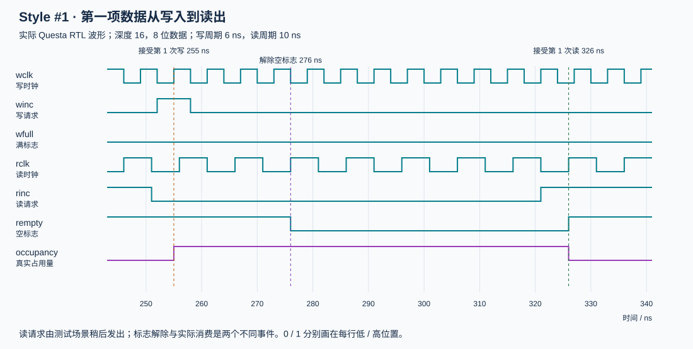
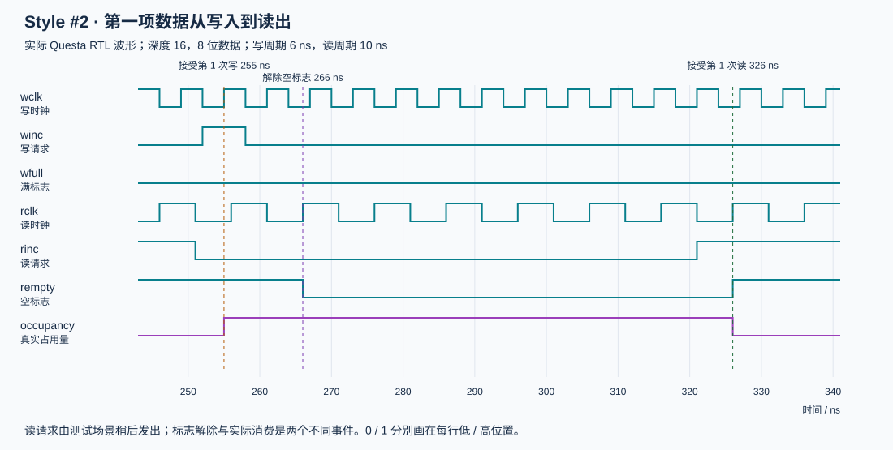

# 异步 FIFO 实测仿真报告

报告生成时间：2026-10-19 23:11:32（Asia/Shanghai）。

## 1. 结论与环境

**33/33 组全部通过**：Style #1 共 18 组，Style #2 共 15 组。

- 仿真器：本机 QuestaSim-64 2024.1，Windows。
- 执行命令：`python sim/run.py --sim questa --vcd`。
- 编译：RTL、接入示例和测试平台均已编译，Errors=0 / Warnings=0。
- 保留信号：`-voptargs=+acc`，解决默认优化后 VCD 可能缺少信号的问题。
- 仿真中的 `vopt-10587` 是保留调试信号导致部分优化关闭的提示，日志完整保留。
- Icarus 分支已提供，本次未安装/运行，不能把本次结果表述为双工具验证。

累计有效写入 **78,313** 次、逐笔核对有效读取 **77,851** 次；满时写请求被阻止 **58,688** 次、空时读请求被阻止 **92,527** 次；同一时间接受读写 **19,346** 次。

累计写数与读数不相等是预期行为：每例都在填满后执行运行中复位，丢弃当时全部数据。当前占用量在结束时已经排空。

## 2. 参数矩阵

每组时钟/参数分别使用随机种子 1、42、2026。半周期单位为 ns；读时钟初相位同样以 ns 表示。

| 地址位数 / 深度 | 数据宽度 | 写半周期 | 读半周期 | 读相位 | Style #1 | Style #2 |
|---|---:|---:|---:|---:|---|---|
| 1 / 2 | 1 | 3 | 5 | 1 | 3 PASS | 不支持，象限需至少 2 位 |
| 2 / 4 | 8 | 3 | 11 | 0 | 3 PASS | 3 PASS |
| 3 / 8 | 17 | 11 | 3 | 1 | 3 PASS | 3 PASS |
| 4 / 16 | 8 | 3 | 5 | 1 | 3 PASS | 3 PASS |
| 4 / 16 | 32 | 5 | 5 | 0 | 3 PASS | 3 PASS |
| 5 / 32 | 17 | 2 | 13 | 1 | 3 PASS | 3 PASS |

## 3. 每例执行的检查

复位空状态、空读、单项首字读取、三轮填满/排空、满时额外写、空时额外读、4000 个写周期随机请求、1000 个写周期连续双向请求、停止读时钟、停止写时钟、有未读数据时的共同复位、复位后再次填满/排空。

每个被接受的读均逐笔比较数据；独立事务模型检查容量边界；同时检查源 Gray 的单步变化、未接受操作时指针保持、标志非未知值、覆盖门槛和全局超时。等频同相用例要求实际接受过同沿读写。

这不是断言所有瞬间的 full/empty 与真实占用量完全相同：跨域信息具有保守延迟，允许暂时阻止安全但尚未被本地域确认的操作。

## 4. 全部运行证据

各行的计数来自实际日志 `PASS` 行；明细日志位于 `sim/build/<用例>/run.log`。

| 用例 | 有效写 | 核对读 | 阻止写 | 阻止读 | 同沿读写 | 结果 |
|---|---:|---:|---:|---:|---:|---|
| `s1_a1_d1_w3_r5_p1_seed1` | 972 | 970 | 3126 | 1850 | 0 | PASS |
| `s1_a1_d1_w3_r5_p1_seed42` | 970 | 968 | 3075 | 1883 | 0 | PASS |
| `s1_a1_d1_w3_r5_p1_seed2026` | 970 | 968 | 3104 | 1909 | 0 | PASS |
| `s1_a2_d8_w3_r11_p0_seed1` | 990 | 986 | 3113 | 582 | 165 | PASS |
| `s1_a2_d8_w3_r11_p0_seed42` | 991 | 987 | 3043 | 590 | 151 | PASS |
| `s1_a2_d8_w3_r11_p0_seed2026` | 1016 | 1012 | 3056 | 591 | 155 | PASS |
| `s1_a3_d17_w11_r3_p1_seed1` | 4041 | 4033 | 89 | 11327 | 0 | PASS |
| `s1_a3_d17_w11_r3_p1_seed42` | 3997 | 3989 | 89 | 11281 | 0 | PASS |
| `s1_a3_d17_w11_r3_p1_seed2026` | 4043 | 4035 | 89 | 11271 | 0 | PASS |
| `s1_a4_d8_w3_r5_p1_seed1` | 2519 | 2503 | 1662 | 734 | 0 | PASS |
| `s1_a4_d8_w3_r5_p1_seed42` | 2537 | 2521 | 1579 | 734 | 0 | PASS |
| `s1_a4_d8_w3_r5_p1_seed2026` | 2574 | 2558 | 1583 | 734 | 0 | PASS |
| `s1_a4_d32_w5_r5_p0_seed1` | 4040 | 4024 | 152 | 836 | 3123 | PASS |
| `s1_a4_d32_w5_r5_p0_seed42` | 3997 | 3981 | 140 | 877 | 3065 | PASS |
| `s1_a4_d32_w5_r5_p0_seed2026` | 4048 | 4032 | 118 | 860 | 3150 | PASS |
| `s1_a5_d17_w2_r13_p1_seed1` | 893 | 861 | 3446 | 1081 | 2 | PASS |
| `s1_a5_d17_w2_r13_p1_seed42` | 892 | 860 | 3363 | 1080 | 4 | PASS |
| `s1_a5_d17_w2_r13_p1_seed2026` | 906 | 874 | 3386 | 1081 | 3 | PASS |
| `s2_a2_d8_w3_r11_p0_seed1` | 1108 | 1104 | 2995 | 464 | 54 | PASS |
| `s2_a2_d8_w3_r11_p0_seed42` | 1118 | 1114 | 2916 | 463 | 33 | PASS |
| `s2_a2_d8_w3_r11_p0_seed2026` | 1143 | 1139 | 2929 | 464 | 32 | PASS |
| `s2_a3_d17_w11_r3_p1_seed1` | 4041 | 4033 | 89 | 11327 | 0 | PASS |
| `s2_a3_d17_w11_r3_p1_seed42` | 3997 | 3989 | 89 | 11281 | 0 | PASS |
| `s2_a3_d17_w11_r3_p1_seed2026` | 4043 | 4035 | 89 | 11271 | 0 | PASS |
| `s2_a4_d8_w3_r5_p1_seed1` | 2522 | 2506 | 1659 | 731 | 0 | PASS |
| `s2_a4_d8_w3_r5_p1_seed42` | 2540 | 2524 | 1576 | 731 | 0 | PASS |
| `s2_a4_d8_w3_r5_p1_seed2026` | 2577 | 2561 | 1580 | 731 | 0 | PASS |
| `s2_a4_d32_w5_r5_p0_seed1` | 4055 | 4039 | 137 | 821 | 3141 | PASS |
| `s2_a4_d32_w5_r5_p0_seed42` | 4015 | 3999 | 122 | 859 | 3087 | PASS |
| `s2_a4_d32_w5_r5_p0_seed2026` | 4063 | 4047 | 103 | 845 | 3173 | PASS |
| `s2_a5_d17_w2_r13_p1_seed1` | 894 | 862 | 3445 | 1080 | 1 | PASS |
| `s2_a5_d17_w2_r13_p1_seed42` | 893 | 861 | 3362 | 1079 | 3 | PASS |
| `s2_a5_d17_w2_r13_p1_seed2026` | 908 | 876 | 3384 | 1079 | 4 | PASS |

## 5. 波形实例

Style #1：255 ns 接受第一项写入，276 ns 解除空，326 ns 消费第一项。

Style #2：255 ns 接受第一项写入，266 ns 解除空，326 ns 消费第一项。读请求由场景稍后发出，因此读出时间相同。

## 6. 证据文件与可复现性

- `sim/build/compile.log`：本次编译日志。
- `sim/build/results.json`：33 组结果和参数。
- `sim/build/<用例>/run.log`：每组场景、PASS 计数及仿真器消息。
- `sim/build/<用例>/wave.vcd`：已确认含信号声明的实际波形。
- `python sim/render_wave.py`：重绘两张教学时序图。
- `python sim/make_report.py`：完整回归后重建本报告。

以下 SHA-256 标识本报告对应的 RTL、测试平台及接入示例快照；修改源码后应重新执行回归。

| 文件 | SHA-256 |
|---|---|
| `rtl/common/fifo_mem.sv` | `7707461c90a4368545a93051dac6d45fe13a69aabef0b75c642edbfa872b1330` |
| `rtl/common/reset_sync.sv` | `429656485e1ea11d02a1f4c780b6178fc4f30a2777f958bd8836f3e22c3701c5` |
| `rtl/style1/async_fifo_style1.sv` | `a28fd94204cbc043f62213b496556f94567408671cda5555aec45d11f79cf7fd` |
| `rtl/style1/gray_sync.sv` | `5b7bc70db1eeecf66e6cf29ccf5c2a63775db85d5d8de25553dd4a6095eb1910` |
| `rtl/style1/s1_read_ptr.sv` | `9ddc5df52d04e3ab484bee311b8135a47aef337702276a6e93bc0f5f3dcb26b4` |
| `rtl/style1/s1_write_ptr.sv` | `46734951280bfeb2a87a9600c4cbcdbfafe5b7707a9ac1277d07400e5848197c` |
| `rtl/style2/async_fifo_style2.sv` | `1d5451b07eccad6f52a84883c0f281423fadbf60d2469033a498439a35a19ea0` |
| `rtl/style2/s2_async_cmp.sv` | `c754aaa0cf5d7c7fdb36a598d8a124f735523e9636bc24b4a6846884a6621925` |
| `rtl/style2/s2_read_ptr.sv` | `27f15077be3196e6c7353e23a95f6e5ef0a803b9b26c7d6c30c0a02709c45eea` |
| `rtl/style2/s2_write_ptr.sv` | `4b007599a344d03b69a851742f08033722f96028ee8c65a2a2a6e1349e1c7673` |
| `tb/tb_async_fifo.sv` | `0279030576703d0d12aafd62cb042d0cd6154ab44dad9b7d217ce3ea13c51ec2` |
| `examples/async_fifo_example.sv` | `d4840f90883e02f04fb7088f8cd6e1508f70a8225f44938620195a3886c75cba` |

## 7. 验证边界

本次验证没有覆盖真实亚稳态、门级延迟、Gray 总线物理偏斜、实际 RAM 宏、SR 锁存器和异步控制寄存器的映射、STA/CDC/DFT 签核，也没有声称穷尽所有时钟相位与序列。Style #2 的异步比较机制仍需按第二篇论文讨论的条件完成目标工艺检查。
