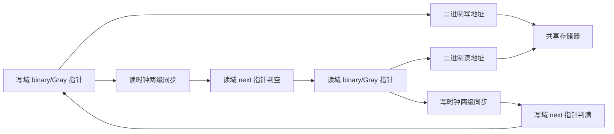

# 异步 FIFO：原理、代码、仿真与工程接入

## 1. 学习路线与设计目标

先阅读本教程第 2～8 节，打开 `rtl/style1/` 对照代码，跑一次 `--quick --vcd`。能够解释“为什么指针加一位、为什么 Gray 高两位反相、为什么用 next 指针”后，再读第 9 节的 Style #2。

本工程解决的问题是：在相互独立的 `wclk` 与 `rclk` 之间，有序传递多位数据；写端不能覆盖尚未读取的项，读端不能消费尚未写入的项。它允许两个时钟频率不同、相位不同，也允许一个时钟临时停止。

教学模型约定：

- 深度为 `2**ADDR_WIDTH`，数据宽度为 `DATA_WIDTH`。
- 每个域每个上升沿最多接受一个操作，指针只向前推进。
- 采用同步写、异步读的存储器，`rdata` 在非空时代表队首。
- 同一个复位请求清空两个域，旧队列内容全部丢弃。
- 普通接入沿 Style #1 完成目标器件验证；Style #2 用于理解另一种架构。

这里的“完整”指提供可读实现、可重复功能仿真和学习说明；尚未指定 FPGA/ASIC，因此没有声称完成某一目标平台的综合、布局布线或签核。

## 2. 为什么跨时钟不能只加两级寄存器

### 2.1 亚稳态与多位一致性是两个问题

一个信号在接收时钟的建立/保持窗口附近变化，接收寄存器可能进入亚稳态。两级同步器给第一级输出更多恢复时间，降低亚稳态传播概率；不能保证概率为零。

多位数据还有一致性问题。例如二进制计数器从 `0111` 到 `1000`，四位都要变化。即使每一位各自经过两级寄存器，接收端也可能组合出一个并未作为源端稳定状态出现的值。

FIFO 不把整条数据总线逐位同步。它先把数据写入共享存储器，再通过跨域的“进度信息”告诉对方哪些位置可读、哪些位置可重用。

### 2.2 为什么不能共享一个 occupancy 寄存器

同步 FIFO 可用同一个时钟更新占用量：写加一，读减一。异步 FIFO 两个事件分别来自不同的时钟，不能让普通寄存器既由 `wclk` 又由 `rclk` 驱动。

因此，写域维护写指针，读域维护读指针。每个指针只有一个时钟驱动，用适当的跨域机制交换信息。

测试平台中的 `occupancy` 由仿真软件统一维护，只用于检查。不要把测试平台里的计数方式综合进硬件。

## 3. 先约定什么时候算“写了/读了”

正常工作时：

```text
write_accept = winc && !wfull    // 在 wclk 上升沿采样
read_accept  = rinc && !rempty   // 在 rclk 上升沿采样
```

复位期间不接受操作，实际 RAM 写使能还包含 `wrst_n`。接口中的 `winc/rinc` 是请求，不能单凭请求增加参考模型计数。

| 请求 | 阻止标志 | 行为 |
|---|---|---|
| `winc=1` | `wfull=0` | 写当前地址，再推进写指针 |
| `winc=1` | `wfull=1` | 不写 RAM，不推进指针 |
| `rinc=1` | `rempty=0` | 接收端取得沿前队首数据，再推进读指针 |
| `rinc=1` | `rempty=1` | 不接受数据，不推进指针 |

### 3.1 为什么读数据要在指针变化前采样

存储器代码为：

```verilog
always @(posedge wclk)
    if (write_en) mem[waddr] <= wdata;
assign rdata = mem[raddr];
```

假设当前队首为 `8'hA5`，下一个元素为 `8'h3C`。在一次有效读沿，接收端应采样 `A5`。同一时刻 DUT 的非阻塞赋值随后更新读指针，组合 `rdata` 才变为 `3C`。

如果测试平台在上升沿后延迟一段时间再把 `rdata` 当作本次消费的数据，就会错比下一个元素。我们的数据检查在 DUT 非阻塞更新前采样，指针变化检查则在更新完成后进行。

空时 RAM 可能仍输出旧值或 `X`；`rempty=1` 表示这些值不能消费，不要求清零 RAM。

## 4. Gray 码：传进度信息的基础

### 4.1 转换与单比特变化

对二进制数 `b`，反射 Gray 码为：

```text
g = b ^ (b >> 1)
```

| 二进制数值 | 3 位二进制 | 3 位 Gray |
|---:|---|---|
| 0 | 000 | 000 |
| 1 | 001 | 001 |
| 2 | 010 | 011 |
| 3 | 011 | 010 |
| 4 | 100 | 110 |
| 5 | 101 | 111 |
| 6 | 110 | 101 |
| 7 | 111 | 100 |

相邻值以及最后回到第一个值都只变化一位。源端每次只推进一步时，跨域采样面对的是一次单比特变化，避免普通二进制进位同时翻转多位的问题。

它有两个前提：源端 Gray 必须先寄存；不同位到接收端的路径也必须受物理约束。不能只写一个组合 XOR，再断言跨域已经安全。

### 4.2 为什么同时保存 binary 和 Gray

本工程每域各保存两个寄存器：

```text
binary_next = binary + accept
gray_next   = binary_next ^ (binary_next >> 1)
binary      <= binary_next
gray        <= gray_next
```

二进制适合加法和存储器地址，Gray 适合跨域。两套寄存器换取较简单的组合逻辑。这就是论文所说的 **Gray counter Style #2**。

**FIFO Style #1 与 Gray counter Style #2 可以同时出现。** 第一篇 Rev 1.2 的最终 RTL 已采用这种组合；不能从计数器的 Style 编号推断 FIFO 比较架构。

### 4.3 慢时钟会跳过一些 Gray 值，是否出错

不会仅因为“跳过值”就出错。接收端相邻两次观察可能相差多个源计数，因此观察值之间也可能有多位不同。需要保证的是每个**源端实际相邻变化**只有一位，以及总线传播满足时序约束。

所以单比特断言要检查源端 `wgray/rgray`；不要对两级同步后的指针强行要求每拍单比特变化。

## 5. Style #1 总体结构



顶层 `async_fifo_style1.sv` 只负责连接。写域代码在 `s1_write_ptr.sv`，读域在 `s1_read_ptr.sv`，两个方向共用 `gray_sync.sv`，存储器放在 `fifo_mem.sv`。

命名含义：

| 本工程名字 | 论文常用名字 | 含义 |
|---|---|---|
| `wbin/rbin` | `wbin/rbin` | 本地域二进制指针 |
| `wgray/rgray` | `wptr/rptr` | 源端已寄存的 Gray 指针 |
| `synced_rgray` | `wq2_rptr` | 读指针同步到写域后的第二级输出 |
| `synced_wgray` | `rq2_wptr` | 写指针同步到读域后的第二级输出 |
| `waddr/raddr` | `waddr/raddr` | 二进制指针低位，访问 RAM |

### 5.1 同步器的每一拍

在接收域上升沿执行：

```verilog
stage1 <= gray_async;
stage2 <= stage1;
```

非阻塞赋值右侧取沿前旧值，因此第二级取的是旧的第一级，不是刚采样的新值。第一级不要再扇出到比较器或其他功能逻辑；比较器只使用第二级。

`ASYNC_REG` 是给识别和布局工具的属性提示，不能替代布局、时序约束和 CDC 检查。

## 6. Style #1：满空公式的推导

### 6.1 为什么指针比地址多一位

深度为 8 时，地址只需 3 位，但读写地址相同可能对应两种状态：刚好读空，或者写指针领先一整圈、刚好写满。

让指针使用 4 位、按模 16 计数：

```text
地址 = binary_pointer[2:0]
空：write_pointer == read_pointer
满：write_pointer - read_pointer == 8  (mod 16)
```

例如读指针为 `0000`：写指针 `0000` 代表空，`1000` 代表满。二进制情况下，满时高位相反、低位相同。有效容量是完整 8 项，不需要空出一个位置。

### 6.2 Gray 码判满为什么反相最高两位

设地址位数为 `A`，完整二进制指针为 `b[A:0]`：

```text
g[A]   = b[A]
g[A-1] = b[A] ^ b[A-1]
g[i]   = b[i+1] ^ b[i]        (i < A-1)
```

满时写指针比读指针多 `2**A`。在模 `2**(A+1)` 范围中，只翻转二进制最高位，其余位相同。

由上述关系可见，Gray 的 `g[A]` 和 `g[A-1]` 都翻转，剩下的位保持不变。因此：

```text
empty_next = (rgray_next == synced_wgray)
full_next  = (wgray_next == invert_top_two(synced_rgray))
```

以深度 8 为例：

```text
read  binary 0000 -> Gray 0000
write binary 1000 -> Gray 1100
                       ^^ 最高两位不同
```

原文常见表达式为：

```verilog
{~synced_rgray[A:A-1], synced_rgray[A-2:0]}
```

本工程使用 XOR 掩码实现同一变换，兼容 `A=1`，避免低位切片出现负下标。

### 6.3 为什么比较 next 指针

假设还有一个空位，当前 `wfull=0`。本次 `winc=1`，当前写入合法，写完后就应该报告满。

时钟沿前组合计算：

```text
wbin_next  = wbin + (winc && !wfull)
wgray_next = gray(wbin_next)
full_next  = compare(wgray_next, synced_rgray)
```

同一个上升沿把指针和 `full_next` 一起寄存。最后一次合法写被接受，沿后 `wfull=1`，下一拍阻止继续写入。

如果比较旧指针再寄存 `wfull`，通常会迟报一拍，多接受一次写，覆盖队首。读空判断完全对称。

### 6.4 标志是本地域许可，不是全局即时占用量

写域看到的是延迟的读指针；读域看到的是延迟的写指针。

- 读端刚释放一个位置，写域可能还要等待同步传播，`wfull` 才解除。
- 写端刚写入第一项，读域可能尚未看到，`rempty` 暂时仍为 1。
- 读写同时进行时，即使真实占用量没到满/空，本地标志也可能保守地阻止一段时间。

这种延迟会损失短时间吞吐机会，但保护数据。不能写出 `wfull == (model_occupancy==DEPTH)` 这种逐拍严格相等断言；测试应检查“允许的操作是否安全”，并在稳定填满/排空阶段检查标志最终状态。

## 7. 逐拍看空标志解除

假设开始为空，写域已写入一项，写指针在第一个列出的读沿之前稳定。没有同时发生新的写入和读取消。

### 7.1 本工程 Style #1

| 读沿后状态 | stage1 | stage2 | `rempty` | 一直请求读时本沿是否接受 |
|---|---|---|---|---|
| 第 1 个读沿 | 新写指针 | 旧值 | 1 | 否 |
| 第 2 个读沿 | 新写指针 | 新写指针 | 1 | 否 |
| 第 3 个读沿 | 新写指针 | 新写指针 | 0 | 否，沿前仍为空 |
| 第 4 个读沿 | 新写指针 | 新写指针 | 1，若读掉最后一项 | 是 |

这里不仅有两级同步器，还有一级注册的标志判断。标志 always 块在第 2 个沿读取的仍然是旧 `stage2`，所以不能机械地把“两个同步寄存器”说成“两拍后一定已经允许读”。

若源变化刚好与接收沿同时发生，该沿可能观察不到新值；真实电路还存在亚稳态引起的额外延迟。表格描述的是明确前提下的理想 RTL 时序，不是跨域绝对延迟保证。

满标志解除采用同样的传播关系。解除后，外部在下一个本地上升沿才能使用新的许可。

下图来自本工程实际 VCD：255 ns 写入，256/266 ns 完成两级同步，276 ns 解除空标志；测试场景在稍后发出读请求，326 ns 接受读取。


### 7.2 本工程 Style #2

第一项写入导致指针不相等，`aempty_n` 从 0 变为 1，释放空标志的异步置位端：

| 读沿后状态 | `empty_stage1` | `rempty` | 本沿是否接受读 |
|---|---|---|---|
| 第 1 个读沿 | 0 | 1 | 否 |
| 第 2 个读沿 | 0 | 0 | 否 |
| 第 3 个读沿 | 随异步比较更新 | 若读空则置 1 | 是 |

它的置位路径和解除路径并不相同。不能为追求一拍更快，把 Style #1 的比较器直接移到同步器第一级。

同样在 255 ns 写入，本工程 Style #2 在 266 ns 解除空标志。326 ns 的实际读取时间由测试激励决定，不能拿它直接比较架构的最短读延迟。


## 8. 存储器、数据稳定与复位

### 8.1 为什么数据本身不需要逐位同步

写入的数据驻留在一个位置，写指针把“写入完成后的进度”传递给读域。读端等到可读标志后访问对应位置；写端也必须等读进度返回后才可重用位置。

这是存储器与控制协议共同保证的。若换成器件 RAM，需确认读延迟、双口行为、同地址冲突行为及数据建立时间。不能把任意组合总线跨域都类比成 FIFO 的 RAM 数据通路。

### 8.2 同步读 BRAM 不能只替换一行代码

本工程的组合读自然呈现当前队首。许多 FPGA 块 RAM 是同步读，地址提交后数据下一拍或更晚才有效。

改用这类 RAM 时，需要设计读流水线、预取/输出寄存器、数据有效状态，并重新定义何时消费、何时推进地址。某些同步读设计还需处理已读出但尚未被下游消费的数据。应把 RAM 接口和 FIFO 外部协议一起改，再重新验证。

### 8.3 为什么不复位整块 RAM

FIFO 复位的逻辑含义是丢弃旧队列内容。只要读写指针归零、读端报告空，旧位值就不具备有效性。逐项清零大数组没有必要，还可能妨碍 RAM 推断。

### 8.4 复位的正确边界

两域使用同一个 `arst_n` 请求，通过两个 `reset_sync` 分别产生 `wrst_n/rrst_n`：

```text
arst_n 拉低 -> 两个域立即进入复位
arst_n 拉高 -> 各域经过本地两次上升沿后释放复位
```

指针和标志逻辑在释放边沿仍读取旧复位值，随后才开始正常工作。外部源和接收端也必须遵守本地域复位状态。

时钟停止时，复位仍可异步生效；释放要等该域时钟恢复。复位时多位 Gray 同时归零没有违反正常操作的单步约定，因为此时所有原数据均已失效。

**只复位一侧不能当成安全清空方案。** 另一侧可能仍持有旧指针和有效数据状态；如需在线独立复位，应另外设计清空握手/重新初始化协议，本工程没有实现这种功能。

## 9. Style #2：异步比较与四象限方向判断

### 9.1 少一位指针后，如何区分满和空

Style #2 只使用 `ADDR_WIDTH` 位指针。两个指针相等时，可能是读端追上写端，也可能是写端绕一圈追上读端。

它增加一个历史状态 `direction`：

```text
指针相等 && direction=0 -> empty
指针相等 && direction=1 -> full
```

方向在指针真正相遇前，通过最高两位的四象限关系预先设置。Gray 高两位沿计数顺序循环：

```text
00 -> 01 -> 11 -> 10 -> 00
```

写指针落后读指针一个象限时，设置“正在趋向满”；写指针领先读指针一个象限时，设置“正在趋向空”。其余情况保持历史状态。

| 读指针象限 | 写指针在这里时设 `direction=1` | 写指针在这里时清 `direction=0` |
|---|---|---|
| 00 | 10 | 01 |
| 01 | 00 | 11 |
| 11 | 01 | 10 |
| 10 | 11 | 00 |

这些象限来自 Gray 指针最高两位，不是对 Gray 码直接做数值大小比较。

### 9.2 一个深度 8 的填满例子

读指针停在二进制 0 / Gray `000`：

1. 复位令 `direction=0`，两个指针相等，报告空。
2. 写两项后，写指针 binary 2 / Gray `011`，写象限 `01`，领先读象限 `00`，方向保持“趋向空”。
3. 写六项后，写指针 binary 6 / Gray `101`，写象限 `10`，相对读象限落后一象限，方向改为“趋向满”。
4. 写满八项后，写指针按 3 位回绕到 `000`，再次与读指针相等；此时方向为 1，判定为满。

方向不是精确占用量，也不表示当前读写速度谁快；它是区分下一次相等含义的历史记忆。

### 9.3 对照异步比较代码

令 `N=ADDR_WIDTH-1`：

```text
x = wgray[N]   XOR rgray[N-1]
y = wgray[N-1] XOR rgray[N]
going_full  = x && !y
going_empty = !x && y
```

`going_full` 与 `going_empty` 在稳定的合法逻辑值下互斥。方向元件在两者都为 0 时必须保持，所以 `always @*` 故意不写最后的 `else`。这不是遗漏默认赋值导致的无意锁存器。

```text
aempty_n = NOT(equal && !direction)
afull_n  = NOT(equal &&  direction)
```

`_n` 表示低有效，`a` 表示异步比较产生的控制。`aempty_n=0` 是“空控制正在有效”，不是“不空”。

### 9.4 “异步置位，同步解除”究竟指什么

以满为例：最后一次写使写指针与读指针相等，方向为 1，`afull_n` 拉低，通过异步控制端把满标志的两级寄存器都置 1。读端后来读取数据，指针不再相等，`afull_n` 拉高；写域再用两拍把 0 移入，解除满标志。

虽然触发满置位的是写指针变化，且该变化源于 `wclk`，满标志仍通过“指针寄存器 → 比较 → 异步置位端”传播，并不是普通 `D` 输入注册的满标志。

关键路径包括：

```text
本地域时钟 -> 指针 clock-to-Q -> 相等/方向逻辑
           -> 标志异步置位 -> 依赖标志的控制逻辑
           -> 下一次本地域时钟前满足建立时间
```

如果路径太慢，下一拍可能来不及阻止多余操作。还要分析异步控制脉冲宽度、恢复/移除时间、锁存器映射和测试结构。Gray 码的单步属性不是免除这些检查的理由。

### 9.5 为什么它能用 Gray 地址访问 RAM

Style #2 的指针没有额外圈数位，完整 N 位 Gray 序列恰好遍历 `2**N` 个不同地址。因此可以按 Gray 顺序访问全部存储位置；读写都使用同一序列，事务顺序保持一致。

不要把 Style #1 的 `ADDR_WIDTH+1` 位 Gray 指针简单截去最高位后当 RAM 地址。反射序列的两半可能产生重复低位，原文第一篇 §5.2 专门讨论了这一陷阱。Style #1 在这里直接采用二进制低位地址。

### 9.6 从论文到工程还差什么

本工程方向锁存器是行为描述；原文采用过针对旧工艺库的特殊写法。综合工具是否能映射、能否正确分析，必须按实际单元库确认。

第二篇 §7.1 的编辑补充直接指出 STA/DFT 不友好。学习时应同时理解算法和实现条件，不能仅凭软件仿真通过就把它视为任何目标器件的通用模板。

## 10. 自检仿真怎样避免“看起来对”

### 10.1 参考模型只认接受事务

测试平台在一个监视进程里统一更新 `head/tail`：

```text
有效写：expected[tail] = wdata；tail++
有效读：检查 rdata == expected[head]；head++
occupancy = tail - head
```

它不复制 Gray 编码、满判断或象限译码，所以不会因模型和 RTL 使用同一个错误公式而一起“通过”。

同时发生读写边沿时，先收集两个操作的接受条件，基于操作前占用量检查安全，再统一更新模型。测试平台的 `#0` 用于合并同一仿真时刻的两个边沿，并在 DUT 非阻塞更新前采样。`#0.001` 则用于更新后的指针检查，这些延迟只在测试平台中使用。

### 10.2 检查项

| 场景/检查 | 要发现的问题 |
|---|---|
| 上电与运行中复位 | 指针/标志初始化、旧数据是否丢弃 |
| 单项写入后读取 | 首字可见、FWFT 采样位置 |
| 连续填满并额外写 | 满判断晚一拍、RAM 满时覆盖队首 |
| 连续排空并额外读 | 空判断晚一拍、无效读推进指针 |
| 多轮填满/排空 | 指针回绕、圈数或方向错误 |
| 随机并发读写 | 顺序错误、丢失、重复、容量错误 |
| 一直请求读写 | 接口背压、标志保守延迟下的持续工作 |
| 相同相位的双时钟 | 同时接受读写及测试平台竞争问题 |
| 暂停读时钟 | 写满后停止，恢复后能够排空 |
| 暂停写时钟 | 读空后停止，恢复后能够工作 |
| 源 Gray 单步/停止检查 | 指针无请求误动、源端单比特性质破坏 |
| 覆盖门槛与看门狗 | 没有真正到达边界、死锁但未报错 |

测试平台还检查标志不能为未知态。被满/空阻止的请求有计数，填满和排空后明确检查标志与占用量，确保边界测试确实发生。

### 10.3 为什么测试里写入量不等于读出量

运行中复位测试会先填满队列，再复位丢弃其中全部数据。因此最终累计 `writes-reads` 等于那次被丢弃的深度，而最终当前队列仍为空。日志的累计计数跨复位保留，`head/tail/occupancy` 则在复位时清零。

### 10.4 测试能证明到哪一步

这里执行的是数字 RTL 功能验证，不模拟模拟电路中的亚稳态，不验证实际路径延迟、脉冲宽度或具体工艺寄存器的 recovery/removal。覆盖的是报告列出的组合与场景，不是对所有相位和所有操作序列的形式化证明。

## 11. 自己运行与观察波形

在根目录执行：

```powershell
python sim/run.py --sim questa --quick --vcd
```

先打开 Style #1 的 `wave.vcd`，加入：

```text
wclk, winc, wfull, wdata
rclk, rinc, rempty, rdata
occupancy, debug_wgray, debug_rgray
```

观察顺序：

1. 复位后 `wfull=0`、`rempty=1`，不要求 `rdata=0`。
2. 第一项写入时写指针先走，经过同步传播后才允许读取。
3. 最后一项合法读的沿前仍 `rempty=0`，沿后置空。
4. 最后一个空位合法写入时沿前仍 `wfull=0`，沿后置满。
5. 满时继续请求，写指针不动；后续排空的数据不能被这些请求改写。
6. 真实占用量下降后，满标志可能暂时保持；占用量上升后，空标志也可能暂时保持。

Style #2 再加入 `debug_direction/debug_aempty_n/debug_afull_n`，把视窗放大到最后一次写或读，看指针、相等比较和异步标志在同一时间点的不同 delta 更新；完整时间窗下这些零延迟变化可能重叠显示。

完整回归：

```powershell
python sim/run.py --sim questa --vcd
```

每个用例有独立 `run.log` 和 `wave.vcd`，汇总为 `sim/build/results.json`。出错时脚本返回失败，并保留日志。实际运行记录见 [仿真报告](仿真报告.md)。

重新生成教程中的两幅时序图：

```powershell
python sim/render_wave.py
```

该脚本只读 VCD，按实际事件绘制 SVG，不是手绘的预期波形。图中同一仿真时间内的 delta 更新折叠到最终状态；寄存器建立/保持时间和物理传播延迟不在图中。

## 12. 工程接入检查

### 12.1 两个域分别使用各自的标志

写端根据写域 `wfull` 决定是否接受新数据，读端根据读域 `rempty` 判断数据是否有效。不要直接把一个域的状态拿到另一个域当同步控制。

如果源端不能暂停，需要另行定义丢弃/溢出策略；FIFO 满时忽略请求不等于自动替源端保存未被接受的数据。有效数据的生产者应持有数据直到接受，或显式处理未接受的情况。

### 12.2 同步器与 Gray 总线路径

应完成：时钟定义、源 Gray 寄存器识别、源到接收同步器第一级的路径检查、同步器两级布局、复位同步策略和 CDC 报告审核。

Gray 各位的传播不能任意相差多个源时钟周期，否则接收端可能同时看到来自多个源步进的变化。按目标工具采用总线偏斜和/或最大数据路径约束，使接收端不会混叠连续更新；界限要基于允许的最短源端更新间隔，并留时序余量。两个方向的源更新间隔可能不同。

不要把两域设成异步后就忽略这些物理限制。部分工具中宽泛的 `set_clock_groups` 或 false path 会覆盖最大延迟约束的检查范围，因此必须检查最终生效的异常优先级和实际报告；这里不提供假装可直接套用的通用 SDC。

### 12.3 吞吐、延迟和深度

队列既非空也非满时，每域可每拍接受一项；长期吞吐受慢端及有效请求比例限制。短突发的源端速率高于目的端时，需要足够深度吸收差额，还要考虑同步延迟造成的保守背压。

粗略估计可先计算：

```text
突发新增占用 ≈ 突发持续时间 × max(写入有效速率 - 读出有效速率, 0)
```

再计入初始占用、停顿、反馈延迟和协议余量，并向支持的二次幂深度取整。这只是容量规划起点，最终应按实际业务流量仿真。

### 12.4 Almost full / almost empty 怎样扩展

在 Style #1 中，可以把**已经同步到本地域第二级**的 Gray 指针转换回二进制，再与本地域指针做带圈数位的模差值。

```text
写域估计占用 = wbin - gray_to_binary(synced_rgray)
读域估计可读 = gray_to_binary(synced_wgray) - rbin
```

这仍是延迟视图，不是统一全局计数。写域通常高估占用，读域通常低估可读量。阈值要覆盖反馈与协议延迟，并重新验证边界。本工程没有加入这组端口，以便主线集中在两篇论文的满空机制。

## 13. 常见错误速查

| 错误写法/理解 | 后果 | 正确方向 |
|---|---|---|
| 二进制每位各加两级就跨域 | 多位采样不一致 | 寄存 Gray 指针或完整握手协议 |
| Gray 只反相最高位判满 | 错判满 | 最高两位反相 |
| 当前指针比较后再注册标志 | 边界晚一拍 | 比较 next 指针 |
| 只门控指针，不门控 RAM | 满时覆盖有效数据 | 两者使用一致接受条件 |
| 将 A+1 位 Gray 直接截断做地址 | 反射序列低位重复 | Style #1 用 binary 低 A 位 |
| `rinc=1` 就读参考队列 | 满空阻止时模型失真 | 只记录接受事务 |
| 延迟到读沿后再比本次数据 | 对比到下一项 | 沿前/沿上采样 FWFT 数据 |
| 同步后 Gray 变化也必须单比特 | 快写慢读误报 | 检查源端相邻变化 |
| 只检查写入总数等于读出总数 | 乱序/重复也可能通过 | 逐笔数据与顺序比较 |
| 复位清空 RAM 才算清空 FIFO | 无谓逻辑，可能妨碍 RAM 推断 | 清指针和有效状态 |
| 两域任意独立复位 | 数据/指针解释失配 | 统一清空或另行握手 |
| Style #2 仿真通过就能任意综合 | 单元映射/异步路径未验证 | 单独完成目标实现和签核 |

## 14. 练习与自测问题

1. 对深度 8，计算读指针 binary 3 时的 Gray，以及写满时写指针 binary 11 的 Gray，检查高两位关系。
2. 暂时把判满只反相最高位，预测连续填满测试怎样失败，再恢复代码。
3. 暂时去掉 RAM 写使能中的 `!wfull`，观察额外满写后排空时的数据比较错误。
4. 将写/读半周期换成 2/13、13/2，解释为什么慢域同步指针会跳值。
5. 在 Style #1 波形中找出第一项写入到第一次有效读的全部读时钟沿，验证第 7 节表格的前提。
6. 对深度 8 固定读指针为 0，列出写指针每一步的 Gray、象限和 direction。
7. 思考换成同步读 RAM 后，输出寄存器占用是否也要纳入容量和清空逻辑。

答案提示：第 1 题 binary 3 → Gray `0010`，binary 11 → Gray `1110`。第 2、3 题是用错误注入确认测试能发现实际问题，实验时应保留原版，完成后恢复。

## 15. 回到原文阅读

- 第一篇先看 §2.2/2.3（指针与跨域），§4（双寄存器 Gray），§5.2～5.5（满空、保守性、复位），再看 §6 的全部 RTL，最后看 §12.2 修订。
- 第二篇先看 §3（四象限），§5.3 的异步比较和 §5.4/5.5 的标志逻辑，再认真看 §5.3.6/5.3.7（关键路径和假设），最后看 §7 的修订与限制。
- 页码、模块和教学修改的逐项来源见 [论文对照与改动](论文对照与改动.md)。
